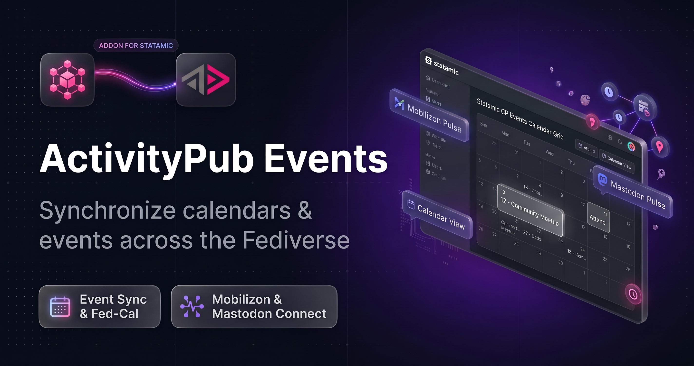
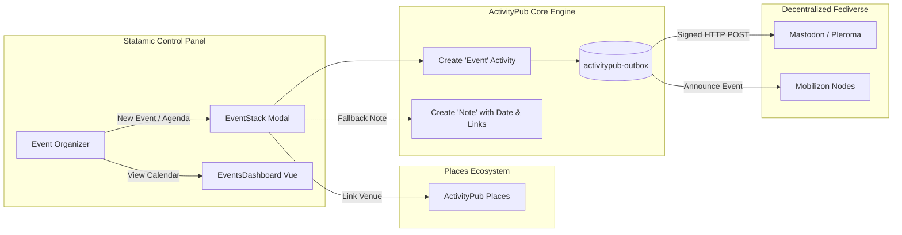
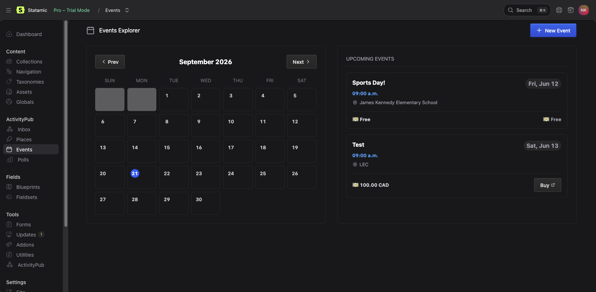
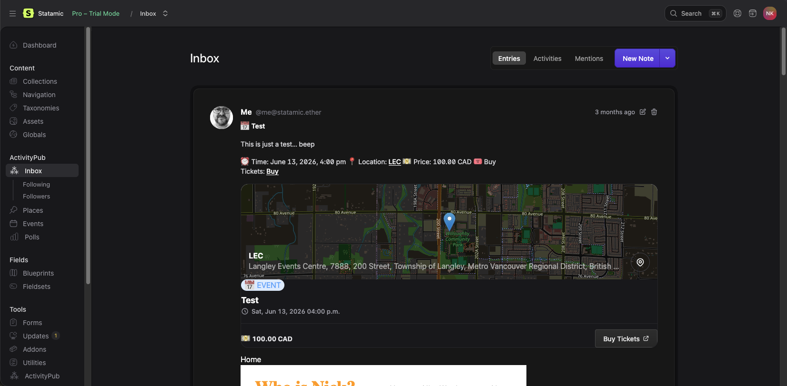
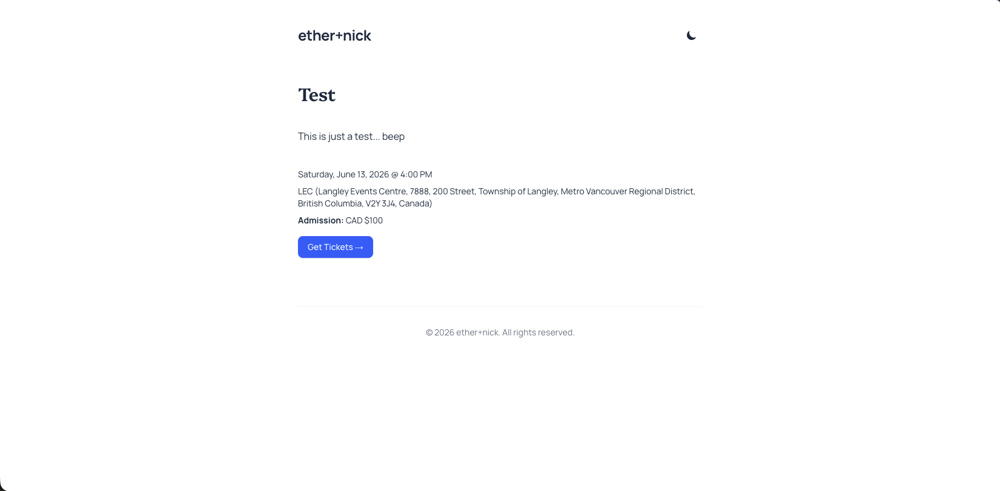

# ActivityPub Events for Statamic

<p align="center">
  
</p>

[](https://statamic.com)
[](CHANGELOG.md)
[](https://php.net)
[](https://mobilizon.org)
[](https://w3.org/TR/activitypub/)
[](LICENSE.md)

> [!NOTE]  
> **Pre-Release:**  
<<<<<<< HEAD
> ActivityPub Events is an early companion addon for [`statamic-activitypub-core`](https://worktree.ca/ethernick/statamic-activitypub-core) and [`statamic-activitypub-places`](https://worktree.ca/ethernick/statamic-activitypub-places). Free for local development and non-production testing under our [Commercial Source-Available License](https://worktree.ca/ethernick/statamic-activitypub-events/src/branch/main/LICENSE.md). Available for feedback ahead of official Marketplace publication.
=======
> ActivityPub Events is an early companion addon for [`statamic-activitypub-core`](https://github.com/ethernick/statamic-activitypub-core) and [`statamic-activitypub-places`](https://github.com/ethernick/statamic-activitypub-places). Free for local development and non-production testing under our [Commercial Source-Available License](https://github.com/ethernick/statamic-activitypub-events/src/branch/main/LICENSE.md). Available for feedback ahead of official Marketplace publication.
>>>>>>> dev

Federate community events, connect OpenStreetMap venues, and broadcast schedules across the Fediverse. **ActivityPub Events** extends [`statamic-activitypub-core`](https://github.com/ethernick/statamic-activitypub-core) and [`statamic-activitypub-places`](https://github.com/ethernick/statamic-activitypub-places) to seamlessly publish W3C ActivityStreams 2.0 `Event` objects to Mastodon, Mobilizon, and the broader social web.

---

## ✨ Features at a Glance

| Feature | Description |
|---|---|
| 📅 **W3C AS2 Event Schema** | Broadcast native ActivityStreams 2.0 `Event` objects with precise UTC start/end times, markdown descriptions, and rich attachments. |
| 🐘 **Mastodon Fallback Notes** | Automatically generates clean, markdown-formatted notes with calendar dates, location links, and ticketing URLs for timeline readers. |
| 🗺️ **Places Integration** | Connect venue records directly to [ActivityPub Places](https://github.com/ethernick/statamic-activitypub-places) with OSM geocoding and Leaflet map previews. |
| 🎟️ **Tickets & Payment Links** | Attach ticket prices and direct checkout links via FEP-0ea0 payment link schema and Schema.org `Offer` integration. |
| 🖥️ **CP Calendar & Agenda** | Manage your event schedule in an elegant, responsive Control Panel calendar with monthly and agenda views. |
| 🎨 **Frontend Antlers Tags** | Render upcoming calendars, individual event cards, and ticketing links using clean, semantic Antlers templates. |
| ⚡ **Zero-Bloat Sidecar Storage** | Event payloads and sidecar metadata are stored cleanly alongside flat-file entries, preserving Stache cache performance. |

---

## 🚀 Quick Start

### 1. Require Package via Composer

Install `activitypub-events` into your Statamic application root:

```bash
composer require ethernick/statamic-activitypub-events
```

### 2. Run the Interactive Guided Installer

Run the one-step guided installer:

```bash
php artisan activitypub:events:install
```

The installer automatically:
- Provisions the **`events`** collection and default `event.yaml` blueprint with date pickers, venue relationships, and ticketing fields.
- Configures `/events/{slug}` routing with `template: events/show`.
- Enables Events federation in `settings/activitypub.yaml`.
- Publishes Control Panel Vue 2 (Statamic 5) and Vue 3 (Statamic 6) assets.

### 3. Display Events on Your Frontend

Add upcoming events to your Antlers layout:

```antlers
<div class="events-grid">
    {{ collection:events sort="start_time:asc" limit="5" }}
        <article class="event-card">
            <h3>{{ title }}</h3>
            <time datetime="{{ start_time | format('c') }}">
                {{ start_time | format('l, F j, Y @ g:i A') }}
            </time>
            {{ if location }}
                <p>📍 {{ location:title or location:osm_name }}</p>
            {{ /if }}
            {{ if ticket_url }}
                <a href="{{ ticket_url }}" target="_blank" rel="noopener noreferrer" class="btn">
                    Get Tickets ({{ ticket_currency or "CAD" }} ${{ ticket_price }})
                </a>
            {{ /if }}
        </article>
    {{ /collection:events }}
</div>
```

---

## 🏛️ System Architecture



---

## 🏷️ Antlers Frontend Tags

Display event details and schedules on your public site using native Antlers templates:

### Event Detail Template (`resources/views/events/show.antlers.html`)

```antlers
<div class="event">
    <h1>{{ title }}</h1>

    <div class="event-meta">
        <time datetime="{{ start_time | format('c') }}">
            {{ start_time | format('l, F j, Y @ g:i A') }}
            {{ if end_time }}
                &ndash; {{ end_time | format('g:i A') }}
            {{ /if }}
        </time>
        {{ if location }}
            <p>📍 {{ location:title or location:osm_name }}</p>
        {{ /if }}
    </div>

    <div class="event-content">
        {{ content | markdown }}
    </div>

    {{ if ticket_url }}
        <div class="event-ticketing">
            <strong>Admission:</strong>
            {{ if ticket_price && ticket_price > 0 }}
                {{ ticket_currency or "CAD" }} ${{ ticket_price }}
            {{ else }}
                Free
            {{ /if }}
            <a href="{{ ticket_url }}" target="_blank" rel="noopener noreferrer">
                Get Tickets &rarr;
            </a>
        </div>
    {{ /if }}
</div>
```

---

## 🖼️ Control Panel Experience

| Events Calendar & Agenda | Event Creation & Venue Stack |
| :---: | :---: |
|  |  |

| Mastodon Federation Proof | Public Antlers Event View |
| :---: | :---: |
|  |  |

---

## 📚 Documentation & Guides

- **[Production Operator & Installation Guide](docs/INSTALLATION.md)** — Requirements, automated setup, timezone recommendations, and Antlers templates.
- **[Troubleshooting & Operations Runbook](docs/TROUBLESHOOTING.md)** — Resolutions for timezone UTC skew, FEP payment links, and queue inspection.
- **[Events Federation & Mobilizon Guide](docs/EVENTS_GUIDE.md)** — ActivityStreams 2.0 `Event` specifications, Mobilizon compatibility, and ticketing standards.
- **[Extension Developer Guide (HOOKS.md)](docs/HOOKS.md)** — Extending outbox formatting, transform hooks, and CP Vue hook points.
- **[Marketplace Launch Blueprint](docs/MARKETPLACE_LAUNCH.md)** — Hero banner specs, screenshot capture briefs, demo video storyboard, and marketing copy pack.
- **[Product Requirements Document](docs/PRD.md)** — Architectural intent, domain models, and technical history.
- **[Task Roadmap & Release Checklist](docs/TASKS.md)** — Punch-list and milestones.

---

## 🤝 Community & Support

- **Bug Reports & Issues**: [GitHub Issues](https://github.com/ethernick/statamic-activitypub-events/issues)
- **Source Code**: [GitHub Repository](https://github.com/ethernick/statamic-activitypub-events)
- **ActivityPub Core**: [Core Addon Repository](https://github.com/ethernick/statamic-activitypub-core)

---

## 📄 License

ActivityPub Events for Statamic is source-available software provided under the **[Statamic Commercial License](LICENSE.md)** (free for local development and non-production testing; requires a valid commercial license for live production deployments).

## 🦾 AI Disclosure

Written with the assistance of AI agents including Gemini & Claude.
