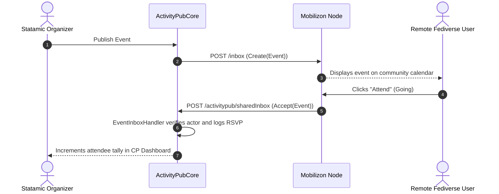

# ActivityPub Events & Fediverse Calendars Specification Guide

This guide details the technical architecture, data structures, W3C ActivityStreams 2.0 vocabulary mapping, and RSVP lifecycle used by the **ActivityPubEvents** addon.

---

## 1. Overview & W3C Vocabulary Mapping

In the W3C ActivityStreams 2.0 specification, an **`Event`** represents any discrete, time-bound gathering, performance, or broadcast.

### ActivityStreams 2.0 Payload Structure:

```json
{
  "@context": [
    "https://www.w3.org/ns/activitystreams",
    {
      "schema": "https://schema.org/",
      "offers": "schema:offers"
    }
  ],
  "id": "https://statamic.example.com/activitypub/events/langley-tech-meetup",
  "type": "Event",
  "attributedTo": "https://statamic.example.com/activitypub/actors/organizer",
  "name": "Langley Tech & Fediverse Meetup",
  "content": "<p>Join us for an evening of open-source discussions and coffee.</p>",
  "startTime": "2026-07-15T18:00:00Z",
  "endTime": "2026-07-15T21:00:00Z",
  "location": {
    "type": "Place",
    "name": "Langley Public Library",
    "latitude": 49.1044,
    "longitude": -122.6582,
    "address": "Langley, BC"
  },
  "attachment": [
    {
      "type": "Link",
      "rel": "payment",
      "href": "https://tickets.example.com/checkout/fedi-meetup",
      "mediaType": "text/html",
      "name": "Buy Tickets"
    }
  ],
  "offers": {
    "type": "Offer",
    "price": "10.00",
    "priceCurrency": "CAD",
    "url": "https://tickets.example.com/checkout/fedi-meetup"
  }
}
```

---

## 2. Mobilizon & Fediverse Client Compatibility

Different fediverse platforms consume events in distinct ways:

| Platform | Event Handling Modality | How ActivityPubEvents Adapts |
| :--- | :--- | :--- |
| **Mobilizon** | Native `Event` object support, full calendar view, and RSVP buttons. | Serializes native AS2 `Event` with full ISO 8601 UTC timestamps and location coordinates. |
| **Mastodon** | Renders events as generic status updates (does not have a native calendar view). | Emits an accompanying `Note` fallback with formatted date, venue, and ticketing links in plaintext. |
| **Lemmy / kbin** | Threaded forum presentation. | Uses the event title as post title and markdown content in the body. |

---

## 3. RSVP Federation Lifecycle

ActivityPub models RSVPs via **`Invite`**, **`Accept`**, and **`Reject`** activities:



1. **Publication**: Publishing an event entry triggers `EventOutboxHandler` to serialize the AS2 `Event` and dispatch `Create(Event)` to followers and remote inboxes.
2. **Attendance (Accept)**: Remote actors indicate attendance, generating an `Accept(Event)` activity delivered to Statamic’s inbox.
3. **Cancellation (Reject)**: If an attendee changes their mind, a `Reject(Event)` activity is sent, removing them from the attendee tally.

---

## 4. Ticketing & Payment Standards (FEP-0ea0)

To support ticketing without complex on-site payment gateways, `ActivityPubEvents` supports **FEP-0ea0 (Payment Links)**:

- Links with `rel="payment"` inside the `attachment` array signal to clients (like Mobilizon or modern microblogging apps) that clicking the link navigates to a direct checkout session.
- An accompanying Schema.org `Offer` object provides machine-readable currency and price values for calendar aggregators.

---

## 5. Storage Model

Events are stored as native Statamic flat-file YAML entries under `content/collections/events/{slug}.md`:

```yaml
id: b3f2081d-862d-45e0-94e8-8a2bf62c1112
blueprint: event
title: 'Langley Tech & Fediverse Meetup'
start_time: '2026-07-15 18:00'
end_time: '2026-07-15 21:00'
location:
  - 8a93ef01-bc29-41e8-a6d1-12003841a555
ticket_price: 10.00
ticket_currency: CAD
ticket_url: 'https://tickets.example.com/checkout/fedi-meetup'
actor:
  - author-actor-id
content: |
  Join us for an evening of open-source discussions and coffee.
```
